# Mi Cartelera Personal

App móvil (React Native + Expo, TypeScript) para buscar películas y series en **TMDB**, agregarlas a una lista personal y organizarlas por estado (*por ver*, *viendo*, *vista*), con calificación y comentario propios. Usa **Firebase Auth** para las cuentas y **Firestore** para guardar la lista, aislada por usuario.

## Objetivo

Integrar en una sola app funcional: autenticación con Firebase Auth, datos propios en Firestore, una API externa pública (TMDB), navegación con React Navigation, estado global con Context API y caché local con AsyncStorage, todo escrito en TypeScript.

## Pantallas

| Pantalla | Contenido | Navegación |
|---|---|---|
| **Login / Registro** | Formulario con validación y alternancia entre modos; errores de Firebase traducidos | Solo sin sesión |
| **Buscar** | Búsqueda combinada de películas y series con carátula, título y año; paginación infinita | Pestaña |
| **Detalle de TMDB** | Póster, sinopsis (con respaldo en inglés y texto alternativo), calificación de TMDB, géneros y elenco; botón *Agregar a mi lista* | Pila |
| **Mi lista** | Filtros por estado y por tipo, contadores, tarjetas con calificación personal; aviso cuando se muestra la copia sin conexión | Pestaña |
| **Editar mi entrada** | Selector de estado, calificación de 1 a 5 (solo si está *vista*), comentario de hasta 500 caracteres y botón *Quitar* con confirmación | Modal de la pila |
| **Acerca de** | Datos de la app, cuenta, logo y aviso de TMDB, cierre de sesión | Pestaña |

## Requisitos funcionales

| # | Cómo se cumple |
|---|---|
| RF1 | `authService` + `initializeAuth` con `getReactNativePersistence(AsyncStorage)`; `RootNavigator` muestra Login o la app según la sesión; `utils/erroresFirebase.ts` traduce los códigos |
| RF2 | `tmdbService.buscar` (`/search/multi`); estados *cargando / error / sin resultados*; póster de relleno |
| RF3 | `tmdbService.obtenerDetalle` con `append_to_response=credits` (detalle y elenco en una petición) |
| RF4 | `listaService.agregarElemento`: id `tipo_tmdbId`, comprobación previa y regla de Firestore |
| RF5 | Filtros por estado y tipo en `MiListaScreen` |
| RF6 | `EditarScreen` + `normalizarCambios`; la calificación se anula si el estado no es *vista* (también en las reglas) |
| RF7 | `Alert` de confirmación antes de borrar |
| RF8 | Cada mutación actualiza estado local + Firestore + AsyncStorage; sin conexión se muestra la última copia con aviso; escrituras con tiempo máximo (`conTiempoLimite`) |
| RF9 | `AcercaDeScreen` con logo y aviso de TMDB y cierre de sesión |
| RF10 | TypeScript estricto sin `any`; capas `screens → context → services` |

## Arquitectura

```text
App.tsx                      Proveedores + navegación
src/
├── components/              Botón, Chip, Estrellas, Póster, estados de carga/error/vacío, logo TMDB
├── context/                 CarteleraContext: usuario, lista, acciones y caché
├── navigation/              RootNavigator: pila + pestañas, login condicional
├── screens/                 Login, Buscar, Detalle, MiLista, Editar, AcercaDe
├── services/                ÚNICO lugar que llama a Firebase, TMDB y AsyncStorage
│   ├── firebaseConfig.ts
│   ├── authService.ts
│   ├── tmdbService.ts
│   ├── listaService.ts
│   └── cacheService.ts
├── types/                   lista.ts (TipoObra, EstadoVisto, ElementoLista), tmdb.ts, peticion.ts, navegacion.ts
└── utils/                   tema, validaciones, traducción de errores, tiempo límite
firestore.rules              Reglas publicadas en Firebase
```

### Tipos principales

- `TipoObra = 'movie' | 'tv'` y `EstadoVisto = 'por_ver' | 'viendo' | 'vista'` (tipos unión).
- `EstadoPeticion<T>` (genérico) para cada petición: `cargando`, `exito` o `error`; se recorre con `switch` exhaustivo.
- `Record<EstadoVisto, string>` exhaustivos para etiquetas, colores e íconos: agregar un estado nuevo obliga a completarlos.
- `RespuestaPaginada<T>` para las respuestas de TMDB.

### Modelo de datos (Firestore)

Ruta: `usuarios/{uid}/mi_lista/{itemId}` con `itemId = tipo_tmdbId` (ej. `movie_550`, `tv_1399`).

Campos: `tmdbId`, `tipo`, `titulo`, `anio`, `posterPath`, `estado`, `calificacionPersonal`, `comentario`, `agregadoEn`, `actualizadoEn` (`serverTimestamp`).

### Seguridad

`firestore.rules` permite leer/escribir solo al dueño (`request.auth.uid == userId`) y además valida en el servidor: campos permitidos, tipos, `itemId == tipo_tmdbId`, estado válido, comentario ≤ 500, calificación entera 1–5 solo si el estado es *vista*, alta siempre en *por_ver*, marcas de tiempo del servidor y que la obra no cambie al actualizar. Todo lo demás está denegado.

## Instalación

Requisitos: Node 20+, app **Expo Go** en el teléfono (o un emulador).

```bash
git clone <url-del-repositorio>
cd mi-cartelera-personal
npm install
cp .env.example .env     # y completar los valores
npm run dev              # equivale a: npx expo start
```

Escanea el código QR con Expo Go. Comprobación de tipos: `npm run typecheck`.

### Variables de entorno (`.env`)

| Variable | De dónde sale |
|---|---|
| `EXPO_PUBLIC_TMDB_TOKEN` | TMDB → *Settings → API* → **API Read Access Token** (se envía como `Bearer`) |
| `EXPO_PUBLIC_FIREBASE_API_KEY` … `EXPO_PUBLIC_FIREBASE_APP_ID` | Firebase → *Configuración del proyecto → Tus apps → App web* |

> **Riesgo de las claves `EXPO_PUBLIC_`:** se incrustan en el paquete de la app y cualquiera podría extraerlas. Para un proyecto no comercial es aceptable; la configuración de Firebase no es secreta (la protección real son las reglas de Firestore), pero el token de TMDB sí podría usarse en nombre de la cuenta. La solución de fondo sería un proxy (por ejemplo Express en Render) que guarde el token en el servidor. `.env` está en `.gitignore`; solo se sube `.env.example`.

### Publicar las reglas

```bash
npm install -g firebase-tools
firebase login
firebase deploy --only firestore:rules --project <id-del-proyecto>
```

## Atribución

This product uses the TMDB API but is not endorsed or certified by TMDB. Datos e imágenes de [The Movie Database (TMDB)](https://www.themoviedb.org/), uso no comercial.

## Evidencias

### Capturas de la app (móvil)

| Iniciar sesión | Buscar | Resultados de búsqueda | Mi lista vacía |
|---|---|---|---|
| 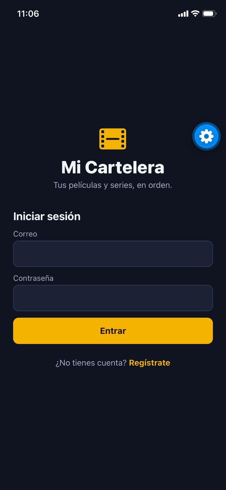 | 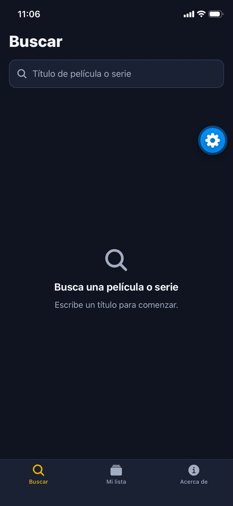 | 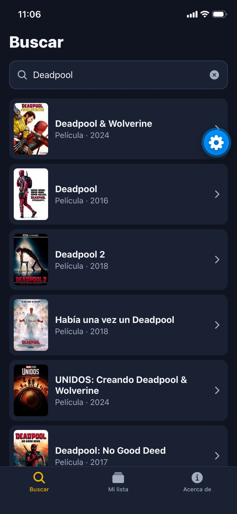 | 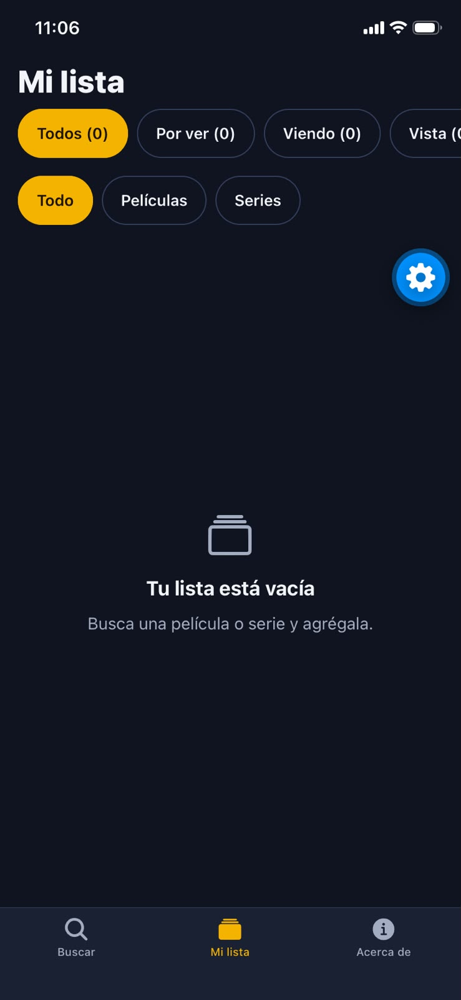 |

| Mi lista con películas | Mi lista con una serie | Filtro por series | Acerca de |
|---|---|---|---|
| 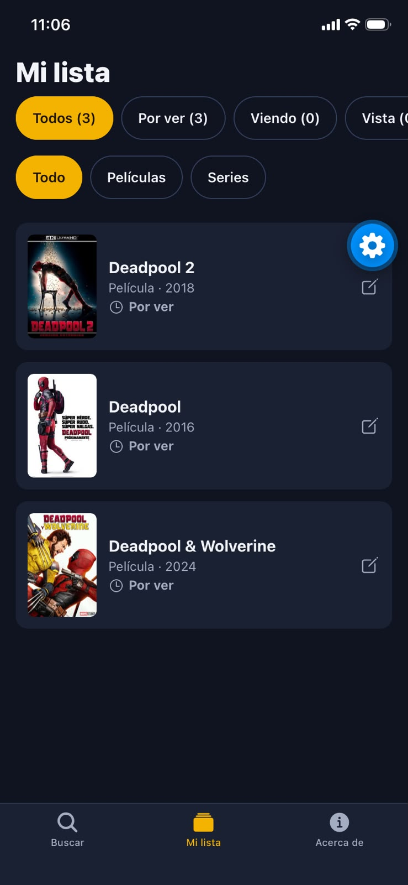 | 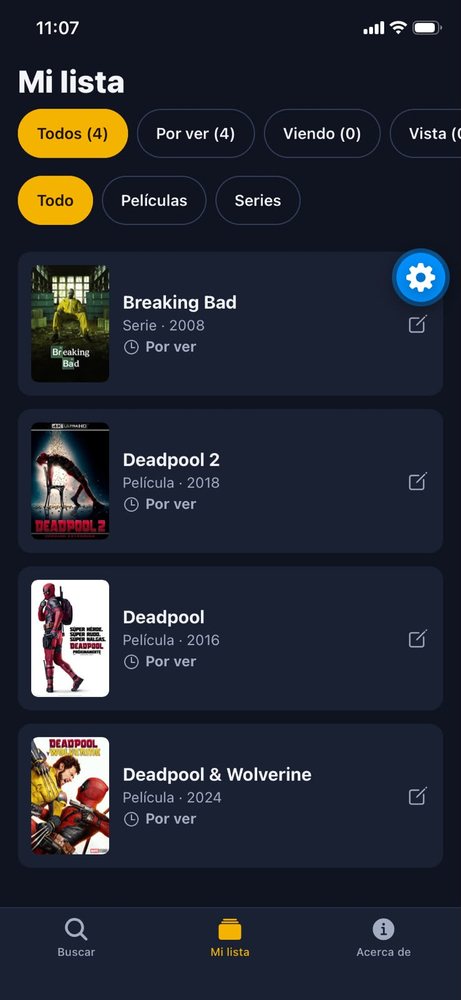 | 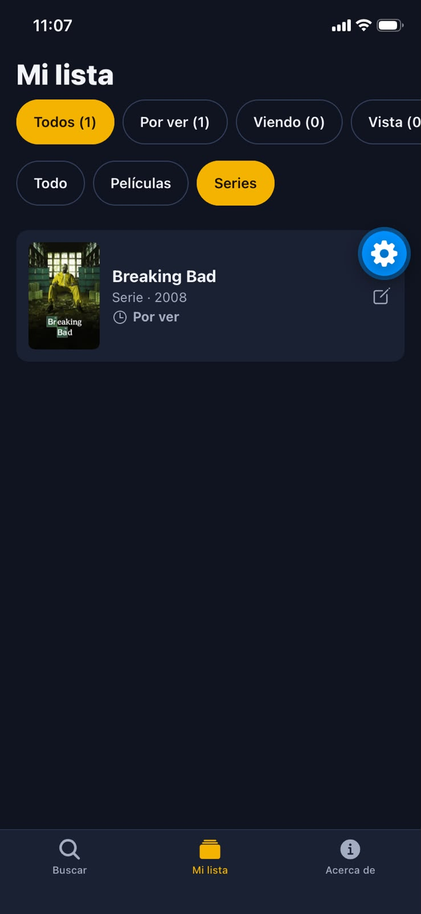 | 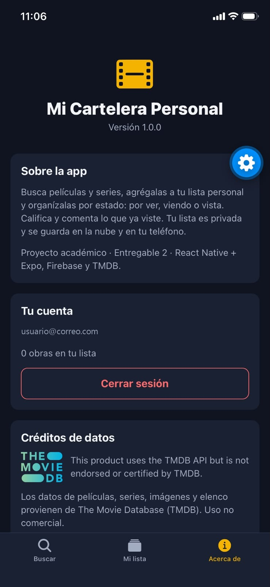 |

### Firebase

**Usuarios registrados** (*Authentication → Users*), incluidas las cuentas de prueba A y B:

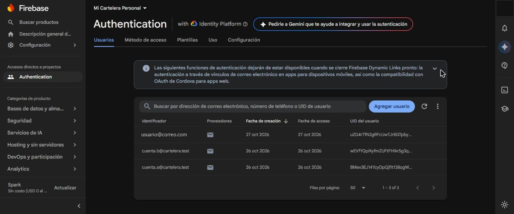

**Subcolección `usuarios/{uid}/mi_lista`** con 4 documentos (id `tipo_tmdbId`):

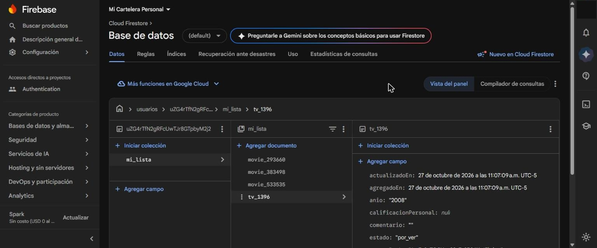

**Simulador de reglas**: la cuenta B no puede leer la lista de otra cuenta; la dueña sí.

| Otra cuenta → rechazado | Dueña → autorizado |
|---|---|
| 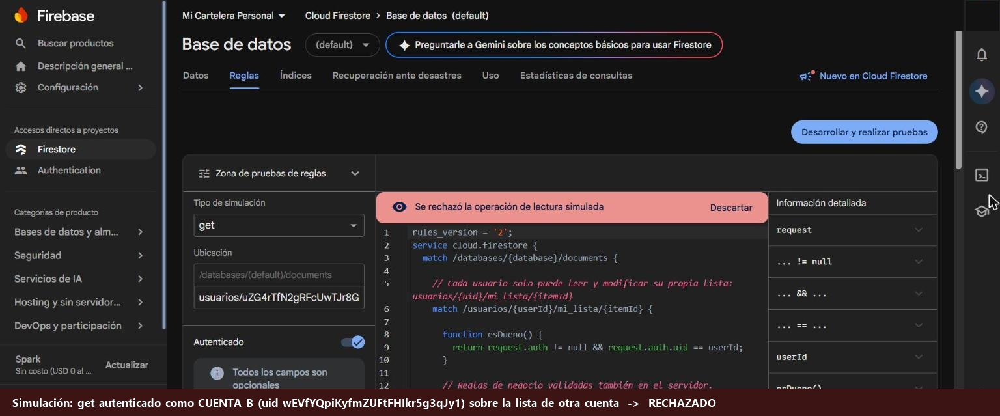 | 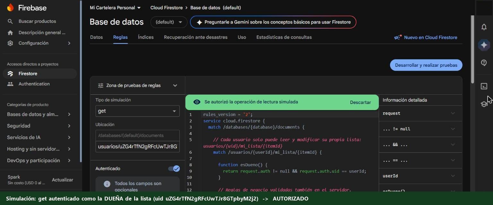 |

## Uso de IA

Ver [`docs/bitacora-ia.md`](docs/bitacora-ia.md).
